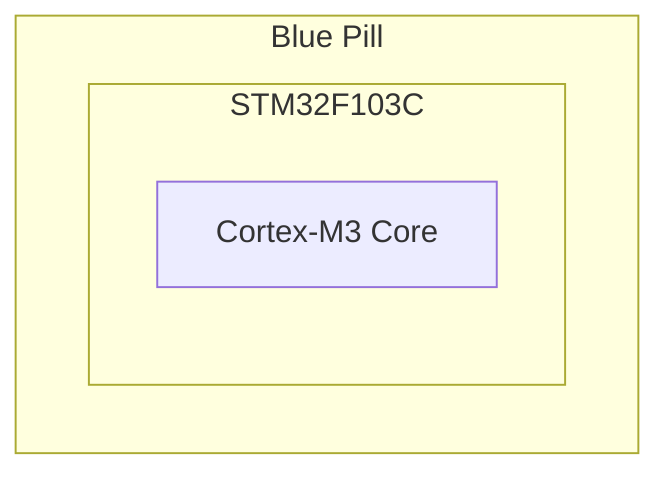

# Board target

## Overall overview

The Blue Pill is a development board built around the STM32F103 family. This
family of processors are based on the ARM Cortex-M3 Core.

## Board Pinout Summary

The STM32F103C8T6 uses the medium-density STM32F103x8 pin definition.

## Blue pill information

| Field             | Value                      |
| ----------------- | -------------------------- |
| Board             | Blue Pill                  |
| MCU ordering code | `STM32F103C8T6`            |
| Silicon family    | STM32F1 medium density     |
| Core              | ARM Cortex-M3              |
| Package           | LQFP48                     |
| Flash             | 64 KiB                     |
| SRAM              | 20 KiB                     |
| Debug             | SWD through ST-Link        |
| Board LED         | Usually `PC13`, active-low |

## Typical board components

| Element               | MCU connection or detail                                                       |
| --------------------- | ------------------------------------------------------------------------------ |
| Onboard LED           | Usually `PC13`, active-low                                                     |
| Reset button          | `NRST`                                                                         |
| Boot jumper           | `BOOT0`; low starts the program from main Flash                                |
| SWD debug pins        | `PA13` is `SWDIO`; `PA14` is `SWCLK`                                           |
| SWD connector signals | `SWDIO`, `SWCLK`, `GND`, and `3.3V` reference or power                         |
| High-speed crystal    | Usually 8 MHz on `PD0` (`OSC_IN`) and `PD1` (`OSC_OUT`)                        |
| Low-speed crystal     | Usually 32.768 kHz for the RTC on `PC14` (`OSC32_IN`) and `PC15` (`OSC32_OUT`) |
| USB connector         | USB device signals: `PA11` (`USB_DM`) and `PA12` (`USB_DP`)                    |
| Power regulator       | Usually converts a 5 V input to the 3.3 V MCU supply                           |
| I/O headers           | Break out MCU GPIO, power, reset, boot, and debug signals                      |
