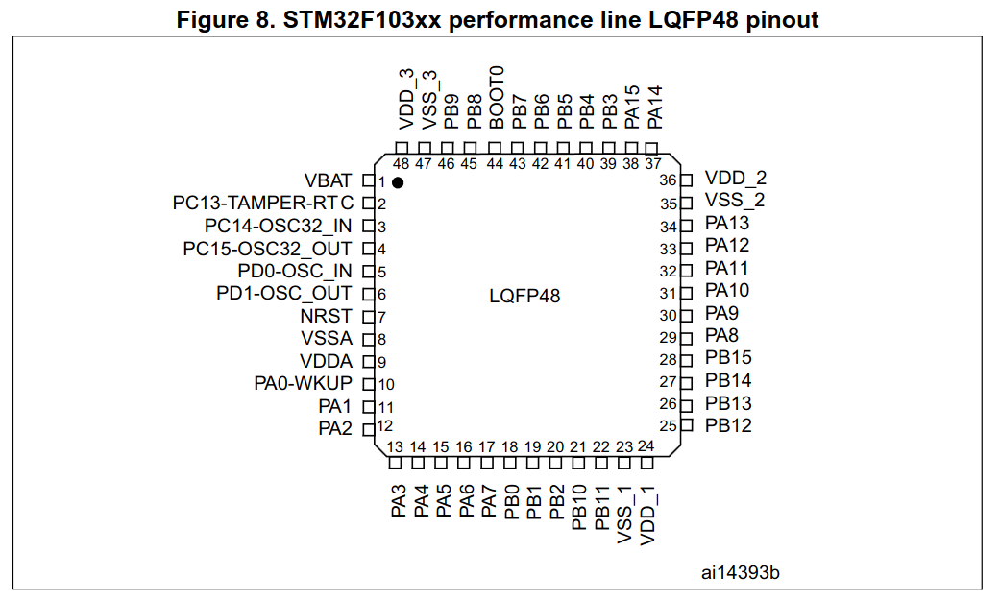

---
hide:
    - toc
---

# STM32F103C8T6 pinout

## Pin dashboard

<noscript>Enable JavaScript to use the interactive pin dashboard. The images and tables below provide the static pin reference.</noscript>

## Encapsulate

This model uses the encapsulate LQFP48 with 48 pines with this distribution:

