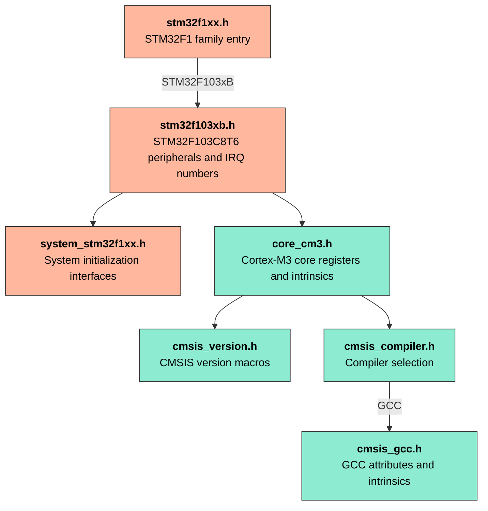

# CMSIS

## CMSIS Key components

| Component    | Purpose                                                             |
| ------------ | ------------------------------------------------------------------- |
| CMSIS-Core   | Provides Cortex-M core registers, intrinsics, and compiler support. |
| CMSIS-Driver | Defines common peripheral driver interfaces for middleware.         |
| CMSIS-DSP    | Provides optimized digital signal processing functions.             |
| CMSIS-NN     | Provides neural network kernels for Cortex-M processors.            |
| CMSIS-RTOS2  | Defines a common interface for real-time operating systems.         |
| CMSIS-Pack   | Packages software components and device support.                    |
| CMSIS-SVD    | Describes peripheral registers for debuggers and tools.             |

This project uses CMSIS-Core and the STM32F1 device headers. It does not use
the other components.

## CMSIS Coding rules

| Rule                 | Purpose                                                                       |
| -------------------- | ----------------------------------------------------------------------------- |
| ANSI C99 and C++03   | Supports common embedded compilers.                                           |
| `<stdint.h>` types   | Gives fixed-width types such as `uint32_t`.                                   |
| Complete types       | Requires explicit types for variables and parameters.                         |
| Parenthesized macros | Preserves expression precedence in macro definitions.                         |
| MISRA C:2012         | Guides safe C code. CMSIS documents deviations and does not claim compliance. |

| Qualifier               | Meaning                                     |
| ----------------------- | ------------------------------------------- |
| `__I`                   | Read-only, `volatile const` in C.           |
| `__O`                   | Write-only, `volatile`.                     |
| `__IO`                  | Read and write, `volatile`.                 |
| `__IM`, `__OM`, `__IOM` | The same permissions for structure members. |

## CMSIS Files

| Header               | Purpose                                                                      |
| -------------------- | ---------------------------------------------------------------------------- |
| `stm32f1xx.h`        | Family entry header. It selects the STM32F1 device header.                   |
| `stm32f103xb.h`      | Defines the STM32F103xB memory map, peripherals, registers, and IRQ numbers. |
| `core_cm3.h`         | Defines Cortex-M3 core peripherals and intrinsics.                           |
| `cmsis_compiler.h`   | Selects compiler-specific CMSIS definitions.                                 |
| `cmsis_gcc.h`        | Defines CMSIS compiler attributes for GCC.                                   |
| `cmsis_version.h`    | Defines the CMSIS version macros.                                            |
| `system_stm32f1xx.h` | Declares STM32F1 system initialization interfaces.                           |



Arrows show which header includes another header in the vendored CMSIS files.
Orange identifies ST device headers. Green identifies Arm core headers.

## CMSIS Symbols

CMSIS source files include `stm32f1xx.h`.

| Symbol        | Purpose                                                                  |
| ------------- | ------------------------------------------------------------------------ |
| `STM32F103xB` | Selects the STM32F103xB header for the STM32F103C8T6.                    |
| `USE_CMSIS`   | Marks a project CMSIS build. It is a project symbol, not a CMSIS symbol. |

For `cmsis-*` applications, the Makefile adds the CMSIS-Core, STM32F1 device,
and project driver include directories. It also adds `-DUSE_CMSIS` and
`-DSTM32F103xB`. The `apps/.clangd` file adds the same paths and symbols for
`cmsis-*` source files.

## CMSIS Repository

CMSIS-Core is maintained in the
[CMSIS repository](https://github.com/ARM-software/CMSIS_6). This project
vendors its CMSIS headers through the
[STM32CubeF1 repository](https://github.com/STMicroelectronics/STM32CubeF1).

Add STM32CubeF1 as a submodule and pin it to the required release:

```sh
git submodule add https://github.com/STMicroelectronics/STM32CubeF1.git vendor/STM32CubeF1
git -C vendor/STM32CubeF1 checkout v1.8.7
```

## CMSIS Helper Macros

The STM32F1 device headers provide these register helper macros.

| Macro                                   | Operation                                      |
| --------------------------------------- | ---------------------------------------------- |
| `SET_BIT(REG, MASK)`                    | Set selected bits to `1`.                      |
| `CLEAR_BIT(REG, MASK)`                  | Clear selected bits to `0`.                    |
| `READ_BIT(REG, MASK)`                   | Read selected bits. It returns a masked value. |
| `MODIFY_REG(REG, CLEAR_MASK, SET_MASK)` | Clear selected bits, then set selected bits.   |
| `WRITE_REG(REG, VALUE)`                 | Replace the whole register value.              |
| `READ_REG(REG)`                         | Read the whole register.                       |
| `CLEAR_REG(REG)`                        | Write zero to the whole register.              |
