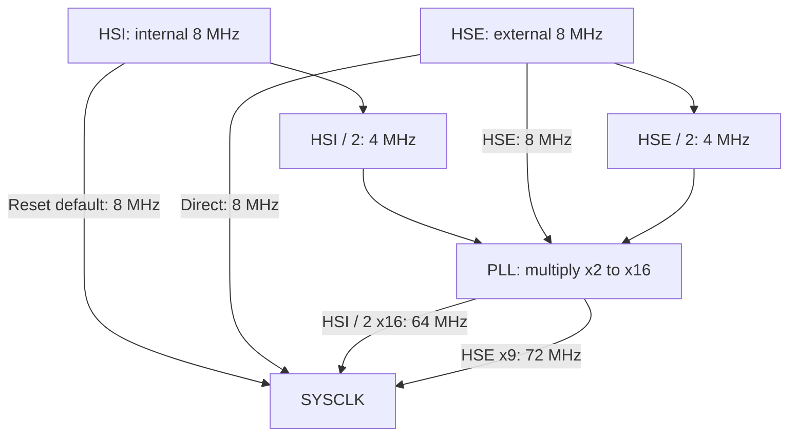
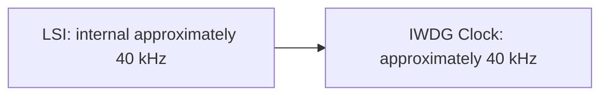
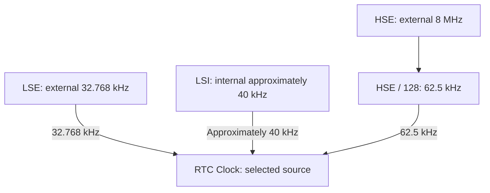
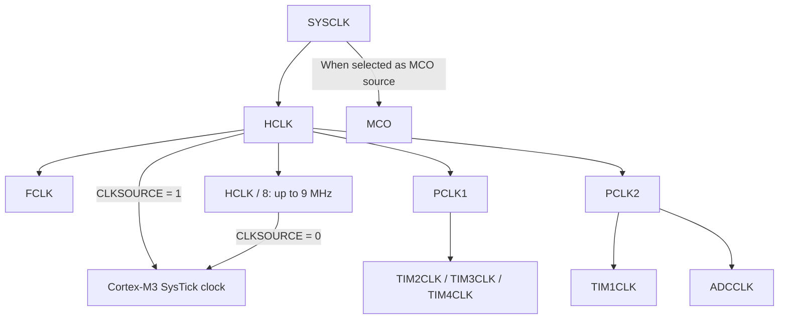
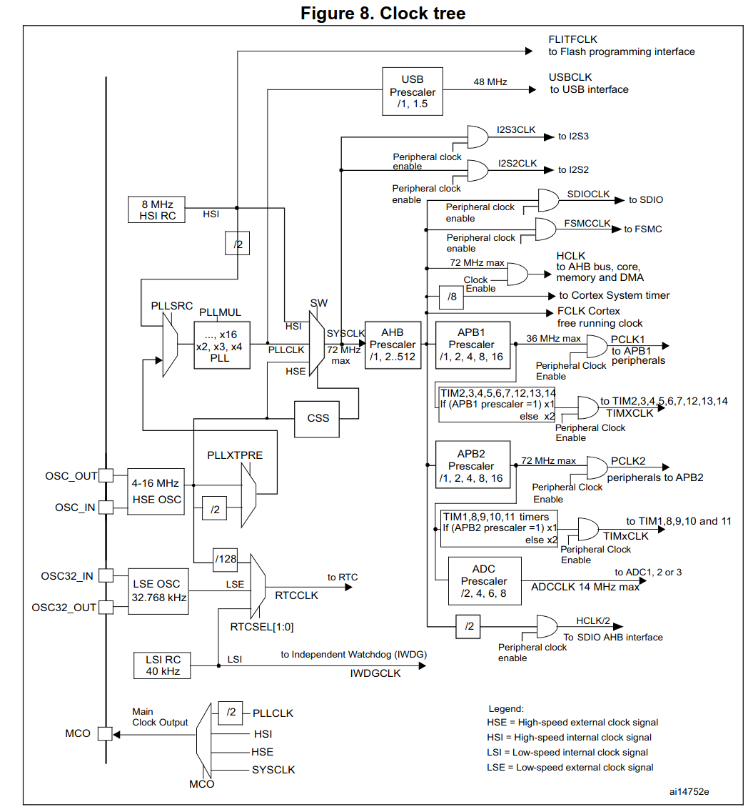

<!--
Copyright (C) 2026 Phyxor Microsystems
SPDX-FileContributor: Pablo Palazon

SPDX-License-Identifier: BSD-3-Clause
-->

# Clock

## Physical Oscillators

| Clock source                | Frequency  | Pins            |
| --------------------------- | ---------- | --------------- |
| `HSE` (high-speed external) | 8 MHz      | `PD0` / `PD1`   |
| `LSE` (low-speed external)  | 32.768 kHz | `PC14` / `PC15` |

## Internal RC

| Clock source                | Nominal frequency    |
| --------------------------- | -------------------- |
| `HSI` (high-speed internal) | 8 MHz                |
| `LSI` (low-speed internal)  | Approximately 40 kHz |

## System Clock

## Independent Watchdog (`IWDG`)

## RTC Clock

## Peripheral Bus Frequency

| Clock                  | Prescaler field and values                            | Maximum frequency               |
| ---------------------- | ----------------------------------------------------- | ------------------------------- |
| System (`SYSCLK`)      | `RCC_CFGR.SW`: HSI, HSE, or PLL                       | 72 MHz                          |
| AHB (`HCLK`)           | `RCC_CFGR.HPRE`: 1, 2, 4, 8, 16, 64, 128, 256, or 512 | 72 MHz                          |
| Core (`FCLK`)          | None                                                  | 72 MHz                          |
| SysTick (`SysTickCLK`) | `SysTick_CTRL.CLKSOURCE`: HCLK or HCLK / 8            | 72 MHz (HCLK); 9 MHz (HCLK / 8) |
| APB1 (`PCLK1`)         | `RCC_CFGR.PPRE1`: 1, 2, 4, 8, or 16                   | 36 MHz                          |
| APB2 (`PCLK2`)         | `RCC_CFGR.PPRE2`: 1, 2, 4, 8, or 16                   | 72 MHz                          |
| TIM2 (`TIM2CLK`)       | `PCLK1` if APB1 prescaler = 1; otherwise 2 x `PCLK1`  | 72 MHz                          |
| TIM3 (`TIM3CLK`)       | `PCLK1` if APB1 prescaler = 1; otherwise 2 x `PCLK1`  | 72 MHz                          |
| TIM4 (`TIM4CLK`)       | `PCLK1` if APB1 prescaler = 1; otherwise 2 x `PCLK1`  | 72 MHz                          |
| TIM1 (`TIM1CLK`)       | `PCLK2` if APB2 prescaler = 1; otherwise 2 x `PCLK2`  | 72 MHz                          |
| ADC clock (`ADCCLK`)   | `RCC_CFGR.ADCPRE`: 2, 4, 6, or 8                      | 14 MHz                          |
| MCO on `PA8`           |                                                       | 50 MHz                          |

## Complete Clock Tree

