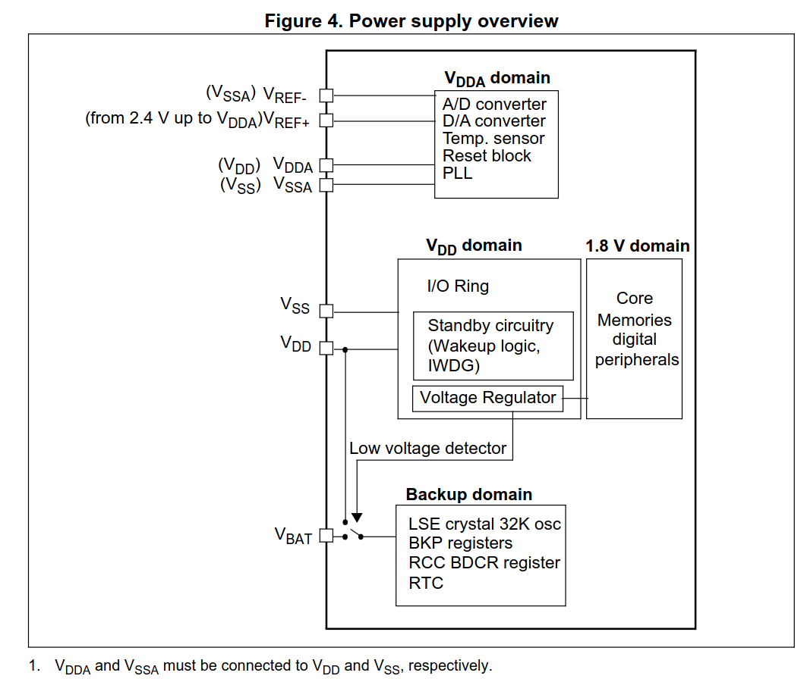

# Power Management

## Power Domains

- `VDDA` domain:
    - Analog parts of ADC1 and ADC2
    - The temperature sensor
    - Reset circuitry
    - PLL
- `VDD` domain:
    - GPIO input/output circuits
    - The internal voltage regulator
    - Voltage detection
    - Standby circuitry (wake-up logic, independent watchdog (`IWDG`)).
- Internal 1.8 V domain:
    - The Cortex-M3 core
    - SRAM
    - Flash interface
    - Digital peripherals (Timers, USART, SPI, I2C, USB, CAN, DMA)
- Backup domain (`VDD` or `VBAT`)
    - The RTC and its registers
    - Backup data registers (`BKP_DRx`),
    - The external low-speed oscillator (`LSE`),
    - `RCC_BDCR`.

## Power Inputs

| MCU pin | Domain supplied                                                                                       | Connect to                                                       | Recommended voltage               |
| ------- | ----------------------------------------------------------------------------------------------------- | ---------------------------------------------------------------- | --------------------------------- |
| `VDD`   | `VDD` domain, internal 1.8 V domain through the regulator, and backup domain while `VDD` is available | Regulated 3.3 V supply for digital circuits                      | 3.3 V                             |
| `VDDA`  | `VDDA` domain                                                                                         | The same 3.3 V supply, with local decoupling for analog circuits | 3.3 V                             |
| `VBAT`  | Backup domain when `VDD` is unavailable                                                               | Backup battery positive terminal, or `VDD` if no battery is used | 3.0 V battery or 3.3 V from `VDD` |
| `VSS`   | Ground return for the digital supplies                                                                | Common ground                                                    | 0 V                               |
| `VSSA`  | Ground return for the `VDDA` domain                                                                   | The same ground as `VSS`, near the analog supply capacitors      | 0 V                               |

Connect every supply and ground pin. Do not leave `VBAT` floating. Place a 100
nF ceramic capacitor near each `VDD` pin, plus a shared 4.7 µF capacitor. Place
100 nF and 1 µF capacitors between `VDDA` and `VSSA`, close to the MCU.

On the Blue Pill, the `5V` pin feeds the onboard 3.3 V regulator. Do not
connect 5 V directly to any MCU supply pin.

## Low-power Modes

### Clocks

| Mode    | CPU clock | HSI / HSE / PLL | Peripheral clocks (AHB / APB) | LSI / LSE | Main power domain / SRAM | Backup domain |
| ------- | :-------: | :-------------: | :---------------------------: | :-------: | :----------------------: | :-----------: |
| Sleep   |     —     |        ✓        |               ✓               |     ✓     |            ✓             |       ✓       |
| Stop    |     —     |        —        |               —               |     ✓     |            ✓             |       ✓       |
| Standby |     —     |        —        |               —               |     ✓     |            —             |       ✓       |

✓ = remains powered or can keep running if enabled; — = stopped or powered off.
The backup domain contains the RTC and backup registers.

- Stop mode preserves `SRAM` and registers.
- On wake-up, `HSI` supplies the system clock.
- Standby mode loses `SRAM` and most register values.
- Wake-up restarts execution through the reset path.

### Entry / Wake-up Low-power Modes

`WFI` waits for an interrupt. `WFE` waits for an event.

Treat the configuration as separate choices: the sleep depth, the wake-up source,
and where execution continues.

| Choice | Setting | Effect |
| ------ | ------- | ------ |
| Sleep depth | `SCB_SCR.SLEEPDEEP = 0` | Select Sleep; `PWR_CR.PDDS` does not select the mode here. |
| Sleep depth | `SCB_SCR.SLEEPDEEP = 1`, `PWR_CR.PDDS = 0` | Select Stop; preserve SRAM, but stop the main clocks. |
| Sleep depth | `SCB_SCR.SLEEPDEEP = 1`, `PWR_CR.PDDS = 1` | Select Standby; wake-up follows the reset path. |
| Stop regulator | `PWR_CR.LPDS = 0` or `1` | `0` keeps the normal regulator; `1` saves more power but increases wake-up time. |
| Wake-up source | `WFI` | Normally wake for an enabled interrupt and run its handler before continuing. |
| Wake-up source | `WFE` | An event can wake the CPU without running an interrupt handler. Interrupts can still run their handlers. |
| Return from a handler | `SCB_SCR.SLEEPONEXIT = 0` | Return to the main program after interrupt handling. |
| Return from a handler | `SCB_SCR.SLEEPONEXIT = 1` | Sleep when the CPU would return to the main program after interrupt handling. |

For Sleep, these examples show the execution flow:

- `WFI`, `SLEEPONEXIT = 0`: Main program → sleep → interrupt handler → main program.
- `WFI`, `SLEEPONEXIT = 1`: Main program → sleep → interrupt handler → sleep again.
- `WFE`, event only: Main program → sleep → event → main program, without an interrupt handler.

`SLEEPONEXIT` controls the return from a handler, not the sleep depth.
Start with Sleep, `WFI`, and `SLEEPONEXIT = 0` to keep the execution flow easy to follow.

- Sleep:
    1. Clear `SCB_SCR.SLEEPDEEP` to `0`.
    2. Clear `SCB_SCR.SLEEPONEXIT` to `0` for entry from the main program. Set
       it to `1` to sleep after the last interrupt handler returns.
    3. Execute `WFI` or `WFE` for immediate entry.
    - Wake-up:
        - `WFI`:
            - An interrupt wakes the CPU.
            - Enable the source in its peripheral and the corresponding
              interrupt in the NVIC.
        - `WFE`:
            - An event wakes the CPU.
            - Configure an event source, such as an EXTI line in `EXTI_EMR`,
              with its edge selected in `EXTI_RTSR` or `EXTI_FTSR`.
        - Execution resumes after the wait instruction. With
          `SCB_SCR.SLEEPONEXIT = 1`, the CPU sleeps again after interrupt handling.
- Stop:
    1. Set `RCC_APB1ENR.PWREN` to `1` to access the power control registers.
    2. Set `SCB_SCR.SLEEPDEEP` to `1` and clear `PWR_CR.PDDS` to `0`.
    3. Set `PWR_CR.LPDS` to `1` for the low-power regulator, or `0` for the
       normal regulator.
    4. Configure the wake-up EXTI line in `EXTI_IMR` for `WFI`, or `EXTI_EMR`
       for `WFE`. Select its edge in `EXTI_RTSR` or `EXTI_FTSR`. Clear pending
       bits in `EXTI_PR` by writing `1`.
    5. Execute `WFI` or `WFE`.
    - Wake-up:
        - With `WFI`, a configured EXTI interrupt wakes the CPU. Enable the
          corresponding interrupt in the NVIC.
        - With `WFE`, a configured EXTI event wakes the CPU.
        - The RTC alarm can wake the CPU through EXTI line 17.
        - Execution resumes with HSI as the system clock. Clear
          `SCB_SCR.SLEEPDEEP` and restore HSE or PLL if the application needs them.
- Standby:
    1. Set `RCC_APB1ENR.PWREN` to `1` to access the power control registers.
    2. Set `SCB_SCR.SLEEPDEEP` and `PWR_CR.PDDS` to `1`.
    3. If PA0 is the wake-up source, set `PWR_CSR.EWUP` to `1` and keep PA0 low
       before entry. Configure the RTC alarm instead if it is the wake-up
       source.
    4. Write `1` to `PWR_CR.CWUF` to clear `PWR_CSR.WUF` before entry.
    5. Execute `WFI` or `WFE`.
    - Wake-up:
        - A rising edge on PA0 wakes the MCU when `PWR_CSR.EWUP = 1`.
        - A configured RTC alarm wakes the MCU.
        - A low level on NRST or an independent watchdog reset restarts the MCU.
        - Execution restarts through the reset path, rather than after the wait
          instruction. Check `PWR_CSR.SBF` to detect Standby, then clear it by
          writing `1` to `PWR_CR.CSBF`.
